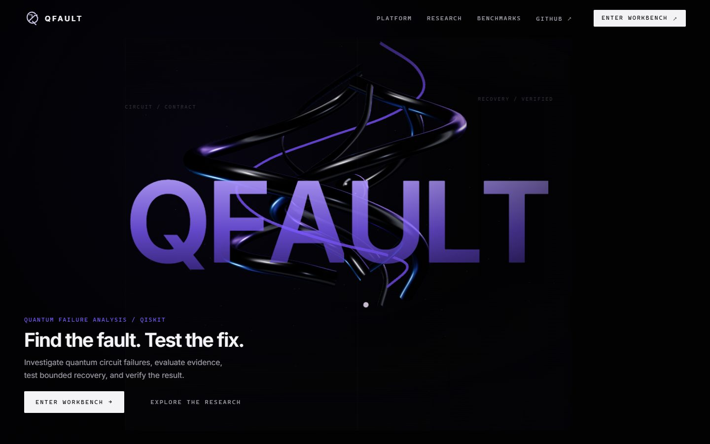
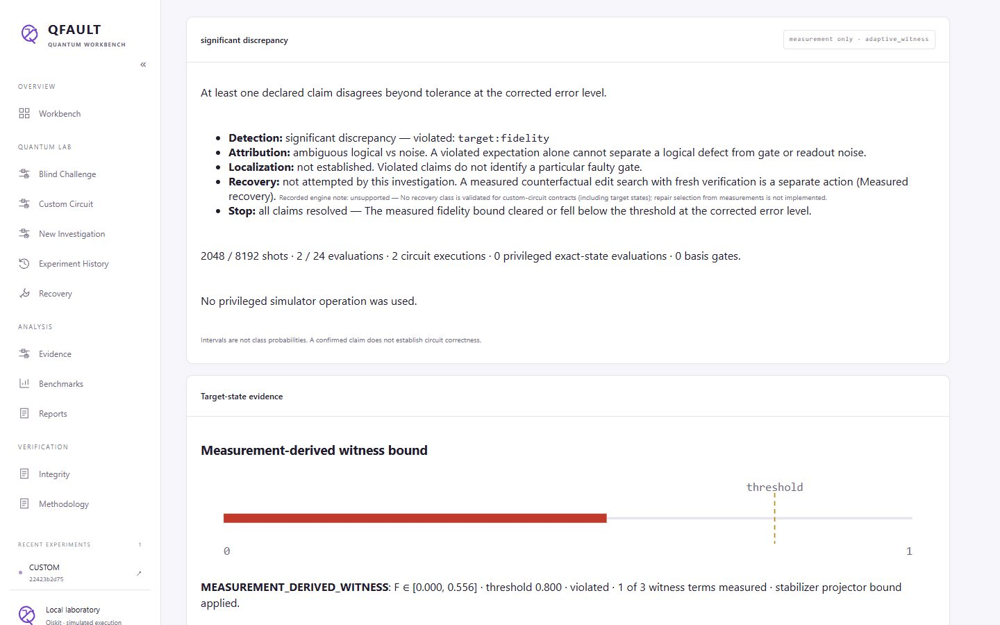
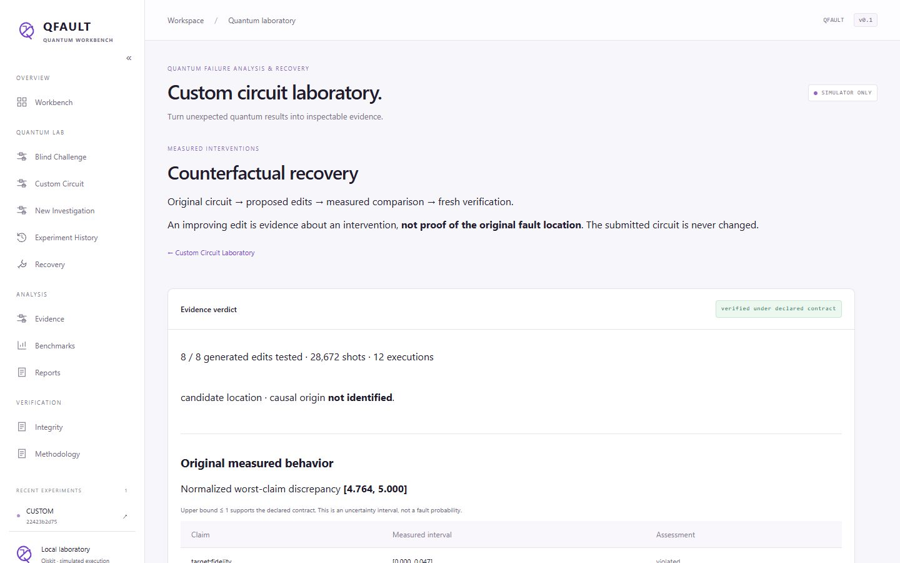

# QFAULT — Quantum Failure Analysis & Recovery Workbench

A Qiskit-based laboratory for investigating quantum circuit discrepancies, testing bounded circuit repairs, and verifying results with measured evidence.



QFAULT runs small quantum circuits (2–5 qubits) on local Qiskit simulators, compares what is measured with a declared behavioral contract, and reports what the evidence does and does not establish:

**quantum observations → contract discrepancy → evidence-aware diagnosis → bounded intervention → fresh verification → auditable report**

Everything is simulated (Qiskit reference simulators and Qiskit Aer). QFAULT makes no hardware, quantum-advantage or universal-verification claims; finite-shot uncertainty, abstentions and negative results are reported alongside successes.

**For judges:** start the server below and choose **Guided demo** on the first
screen, or open <http://127.0.0.1:8000/#/demo>. Follow an imported QASMBench circuit
through an inadequate Z contract, complementary evidence, bounded edits and fresh
verification. Noise-control and insufficient-budget examples execute real
abstentions. No JSON assembly or stored success response is required.

[Judging/setup guide](docs/judging-guide.md) · [Three-minute narration](docs/three-minute-demo.md) ·
[Public delivery and verification](docs/public-release.md)

Current scientific scope and dated records: [current-state index](docs/current-state.md).
The current release adds native circuit import, explicit measured recovery evidence,
parent-linked replay and verifiable source/evidence packages. The earlier reviewed
release at `35cbbb9` has [historical passing CI](https://github.com/PrathamKapoor/QFault/actions/runs/38787130996);
check hosted results for the exact current Git revision separately.

## Quick start

Requirements: 64-bit **CPython 3.13** and **Node.js 24** (tested: Python 3.13.2 on Windows 11, Python 3.13.15 on Ubuntu 26.04 under WSL2, Node 24.19.0). macOS has not been tested.

Windows PowerShell:

```powershell
git clone https://github.com/PrathamKapoor/QFault.git
cd QFault
py -3.13 -m venv .venv
.venv\Scripts\python -m pip install --require-hashes -r requirements.lock
.venv\Scripts\python -m pip install --no-deps -e .
npm --prefix web ci
npm --prefix web run build
.venv\Scripts\python -m qfault serve
```

Linux (bash):

```bash
git clone https://github.com/PrathamKapoor/QFault.git && cd QFault
python3.13 -m venv .venv
.venv/bin/python -m pip install --require-hashes -r requirements.lock
.venv/bin/python -m pip install --no-deps -e .
npm --prefix web ci && npm --prefix web run build
.venv/bin/python -m qfault serve
```

Open <http://127.0.0.1:8000/>. The server binds to localhost only; use `qfault serve --port 8001` if 8000 is taken. The frontend must be built (`npm --prefix web run build`) before the server can serve it.

No external API key, provider account, cloud service or database is required.
Simulation uses local CPU/memory. Keep the server on loopback; it is not an
authenticated Internet service. Personal records stay in ignored `artifacts/`.

### A first real investigation

Open **Custom Circuit** to validate a circuit and an independently declared
contract, inspect feasibility, collect evidence, and optionally run **Measured
recovery**. Native Qiskit object conversion and the local QASM/CLI path are in
the [import guide](docs/native-import.md). A repeatable native-circuit phase
demonstration, noise abstention and insufficient-budget control use the real API:

```powershell
python -m scripts.judging_demo --out artifacts/my-native-demo
python -m qfault verify-report artifacts/my-native-demo/fresh_recovery-report.json
```

The template path remains available:

In a second terminal (same virtual environment):

```powershell
python -m qfault run --family bell --scenario remove --policy phase --backend aer --seed 7
python -m qfault export EXPERIMENT_ID bell-remove.json      # EXPERIMENT_ID: the "experiment_id" field of the run output
python -m qfault verify-report bell-remove.json
```

This executes a Bell circuit with a removed gate on Qiskit Aer, diagnoses it with phase-sensitive evidence, proposes and independently verifies a bounded repair, then exports and checks the hash-consistent report. In the browser, **Enter Workbench → Custom Circuit** lets you submit your own circuit and contract.

### Verify the installation

```powershell
.venv\Scripts\python -m pip check
.venv\Scripts\python -m pytest tests -q            # requires the built frontend
.venv\Scripts\python -m scripts.aer_smoke
```

Optional browser checks need Chromium: `python -m playwright install chromium`, start the server, then `python -m scripts.release_smoke`.

## What QFAULT does

| Capability | What it actually does |
|---|---|
| **Template investigations** | Bell, GHZ and QFT circuits with injected logical faults and gate/readout noise; five diagnostic policies under explicit shot and evaluation budgets. |
| **Custom Circuit Laboratory** | Validated JSON circuits (no arbitrary code) with declared contracts: Z/X/Y measurement distributions, Pauli expectations or a pure target state. Real basis-change measurements, union-bounded finite-shot intervals and an adaptive evidence planner. |
| **Target-state witnesses** | Calibrated common-state Pauli measurements give a *conservative fidelity bound*. Declared uncalibrated readout or analysis noise withholds state certification; exact fidelity remains explicitly simulator-assisted. |
| **Measurement-only vs simulator-assisted** | Measurement-only analysis sees sampled counts and the declared contract, never the candidate state. Simulator-assisted analysis may use privileged exact-state calculations and is labelled as such. |
| **Blind Challenge** | Executes a hidden server-selected scenario, persists a frozen prediction, then reveals evaluator truth. A controlled local exercise, not secrecy from the server operator. |
| **Measured counterfactual recovery** | Tests bounded one-edit changes to a custom circuit by measurement, ranks them conservatively, and confirms a selected edit on fresh samples. An improving edit is not proof of where the original fault was. |
| **Auditable records** | Immutable JSON investigation records, replay and exports with SHA-256 manifests. These are consistency checks, not signatures or authentication. |



### Diagnosis and recovery modes

- **Measurement-only diagnosis** can establish a contract discrepancy but generally cannot separate a logical defect from gate or readout noise; it reports that ambiguity instead of guessing.
- **Simulator-assisted recovery** (template workflow) proposes one-edit repairs using privileged exact-state calculations and validates them with fresh samples plus an independent density-matrix check.
- **Measured counterfactual recovery** (Custom Circuit Laboratory → *Measured recovery*) uses only measurements to screen candidate edits, reserves budget for an independent fresh confirmation, and verifies only when the candidate's upper loss bound clears the declared contract *and* beats the freshly measured original. An ordinary laboratory investigation does not attempt repair by itself.
- **Causal fault localization is not established** by any mode: a contract-restoring edit identifies an intervention, not the original cause.



## Scientific evidence

Raw evidence availability is explicit in the [evidence ledger](docs/evidence-availability.md).
The external study has 2,206 raw exports. The authentic historical measured
recovery study now has a separately versioned 310-export archive, independently
recountable with `python -m scripts.verify_recovery_archive`. Other historical
families retain summary-only limitations where raw acquisition is unavailable.
Source-only and evidence-inclusive [package commands](docs/evidence-availability.md#package-contracts)
have distinct contracts and never require the owner's ordinary runtime store.

Results come from frozen, prespecified simulation evaluations. Denominators are the evaluated cases; intervals in the linked reports are descriptive.

| Evaluation | Result | Source |
|---|---|---|
| Template diagnosis (68 cases per policy, frozen) | Phase-sensitive 66/68 correct vs fixed 58/68, using 40% more shots; two QFT angle faults missed | [findings](docs/diagnostic-findings.md), [summary](benchmarks/diagnostic-final.json) |
| Measurement-only holdout (52 cases per policy) | Complementary measurements raised supported-discrepancy detection from 14/52 to 30/52, but strict category successes stayed 16/52 — more detection, no unique causes | [findings](docs/measurement-holdout-findings.md), [data](benchmarks/measurement-boundary-holdout-20261013.json) |
| Custom laboratory (117-case holdout) | New circuit families and Pauli contracts work; the adaptive planner tied simple schedules and only beat random selection; reference and Aer agree on 113/117 categories per policy | [methodology](docs/custom-circuit-lab.md), [data](benchmarks/custom-lab-holdout-10240.json) |
| Target-state witnesses (414-case holdout) | Bounds covered the historical effective-state oracle fidelity in 165/165 checkable cases per policy/budget; dense non-Clifford targets stayed unconfirmed; adaptive selection was not uniformly better than fixed orders | [methodology](docs/target-state-witnesses.md), [data](benchmarks/target-witness-holdout.json) |
| Measured recovery (62-case holdout, 5 policies) | Conservative policy verified 16/62 overall (16/21 measurement-detected eligible cases), with 0 rejected repairs and 0 proposals on 28 noise controls; point ranking also verified 16/62 but made 5 rejected proposals | [methodology](docs/counterfactual-recovery.md), [data](benchmarks/counterfactual-recovery-holdout.json) |

These are bounded design corpora on simulators. They do not establish performance on arbitrary circuits, hardware reliability, or statistical superiority of any policy.

### External circuit validation

A pinned QASMBench inventory covers all 252 QASM paths (132 canonical originals,
120 transpiled variants). Fourteen originals fit the bounded static importer;
five were development programs and nine were held out. The frozen study ran
1,962 diagnostic and 270 recovery cases, retaining unsupported mutations and all
negative outcomes. All 2,206 executed report bundles are committed and independently
checked. Some external programs share familiar state-preparation or QFT structures.

The [final adversarial gate](docs/final-verification.md) independently reconciles
all rows and exports, reproduces 72 prespecified configurations, and records fresh
Windows/Linux installs plus ten Chromium suites. Its GO verdict applies to the
documented bounded simulator scope and its recorded revision; current-release
verification and evidence availability are tracked separately.

- Adaptive Pauli planning detected **103/108 operational contract violations**
  versus fixed **102/108**, with no observed false violations. This one-run
  difference across repeated seeds is not a statistical superiority claim.
- Target witness policies mostly tied. All **530 checkable intervals** covered
  the oracle fidelity; 54 uncalibrated-noise cases per policy withheld state claims.
- Conservative recovery freshly verified **10/41 eligible cases** (10/90 overall),
  rejected eight proposals and made no noise-only proposals. Point ranking also
  verified ten, but rejected 31 proposals, including 13 noise-only proposals.

[Protocol, exclusions, costs, family results and reproduction](docs/external-validation.md)
explain the separate denominators. The trusted contract comes from the original
external source before mutation; candidate state and evaluator truth never enter
measurement-only decisions. [Five observability examples](benchmarks/identifiability-v1.json)
show both ambiguities that complementary measurements break and ambiguities that
more shots cannot resolve.

To demonstrate one external circuit against a running server:

```powershell
python -m scripts.external_demo --out artifacts/my-external-demo
python -m qfault verify-report artifacts/my-external-demo/recovery-report.json
```

The QRNG example follows a phase discrepancy from Z-only ambiguity to complementary
measurement, bounded intervention and fresh verification. It preserves the source
circuit and records the controlled mutation separately.

[Competitor comparison](docs/competitor-comparison.md) documents substantial prior
work: Qrep already repairs circuits using sampled behavior tests; MQT Debugger
supports simulator debugging and measured runtime assertions; Muskit provides
mutation testing; QCEC checks circuit equivalence with a reference oracle. QFAULT
does not claim to be the first debugger or to outperform those tools.

## Architecture

- `qfault/` — Python package: circuits, contracts and simulation (`quantum.py`), diagnosis (`diagnostics.py`, `measurement.py`), custom laboratory and target witnesses (`lab.py`, `target.py`), recovery (`recovery.py`, `counterfactual.py`, `interventions.py`), evidence storage (`storage.py`, `evidence.py`), FastAPI server (`api.py`) and CLI (`cli.py`).
- `web/` — React/TypeScript/Vite workbench served by the API from `web/dist`.
- `benchmarks/`, `configs/` — frozen evaluation protocols and committed result summaries.
- `scripts/` — evaluation, reproduction and browser verification scripts.
- `docs/` — methodology, findings and historical release records. Runtime call flow: [flow.md](flow.md); design decisions: [decisions.md](decisions.md).

The API is documented at <http://127.0.0.1:8000/docs> while the server runs. One investigation executes at a time in the single local process.

## Reproducibility

Current [release verification](docs/release-verification-20261023.md) records the
tested source, platforms, real browser workflows and package checks. Run
`python -m scripts.verify_replication` to check all 72 retained current-source
replication exports offline. These repeat observed designs and are not a new holdout.

- `requirements.lock` is a hashed, universal lock generated from `pyproject.toml` (which remains authoritative) for CPython 3.13 with the `aer`, `dev` and `browser` extras. Regenerate with `uv pip compile pyproject.toml --extra aer --extra dev --extra browser --universal --python-version 3.13 --generate-hashes -o requirements.lock`; installing from it needs only pip.
- `web/package-lock.json` pins the frontend; use `npm ci`.
- Each frozen evaluation documents its protocol, seeds and reproduction command in the linked methodology file. New runs must use a new output directory; committed results are never overwritten.
- CI ([checks.yml](.github/workflows/checks.yml)) installs from the lock, builds the frontend, runs the full test suite and an Aer smoke test, and runs a Chromium release smoke against a live server.

## Limitations

- Simulation only; no IBM or other hardware execution.
- Contracts describe one declared input state, not full unitary equivalence. Measured witnesses are incomplete; Z-basis distributions cannot see relative phases.
- Exact attribution and exact fidelity require privileged simulation and are labelled.
- Shots are assumed independent and identically distributed; intervals are conservative union bounds, not calibrated probabilities.
- State-fidelity interpretation requires calibrated Pauli measurements of one
  common state. Basis-dependent analysis noise can violate that model even when
  sampling intervals cover every observed mean. Operational distribution/Pauli
  tests do not identify a noiseless preanalysis state. See the [audit](docs/information-boundary-audit.md).
- Repair search is bounded (one edit, capped candidates) and may abstain; verified edits are not causal localization.
- Hash manifests detect inconsistent edits relative to the manifest; they are not signed and anyone who rewrites both data and manifest can rehash.
- Local, single-process server bound to 127.0.0.1.

## Troubleshooting

| Symptom | Cause and fix |
|---|---|
| `GET /` returns 503 "Build the web interface…" | `web/dist` is missing: run `npm --prefix web ci` and `npm --prefix web run build`. |
| `QFAULT cannot start: 127.0.0.1:8000 is already in use` | Another server holds the port: stop it or use `qfault serve --port 8001`. |
| `No module named qfault` or wrong versions | Use the virtual environment's interpreter (`.venv\Scripts\python`) from the repository root. |
| Aer backend unavailable | The `aer` extra is missing; reinstall from `requirements.lock`. |
| Hash mismatch during `pip install` | Use CPython 3.13; the lock is generated for 3.13. |
| Playwright cannot launch Chromium | Run `python -m playwright install chromium` (on Linux, `--with-deps` installs system libraries). |
| Investigation rejected with 422 | Request failed validation or the shot/evaluation budget cannot fund it; the response explains which. |

## Documentation

[Custom laboratory](docs/custom-circuit-lab.md) · [Target-state witnesses](docs/target-state-witnesses.md) · [Measured recovery](docs/counterfactual-recovery.md) · [Capability boundaries](docs/scientific-hardening.md) · [Methodology](docs/methodology.md) · [Benchmark protocol](docs/benchmark-protocol.md) · [Release history and earlier README](docs/release-history.md)

## License and attributions

QFAULT's own code is MIT licensed ([LICENSE](LICENSE)). Third-party portions keep their own terms; see [THIRD_PARTY_NOTICES.md](THIRD_PARTY_NOTICES.md). In particular, the landing hero is transplanted from the MENTAL.AI web client with its authors' permission (as confirmed by the QFAULT owner; see [hero transplant](docs/hero-transplant.md)) and is **not** covered by QFAULT's MIT license grant; React Bits components follow [their license](docs/licenses/react-bits.md); Inter is distributed under the SIL Open Font License 1.1.
