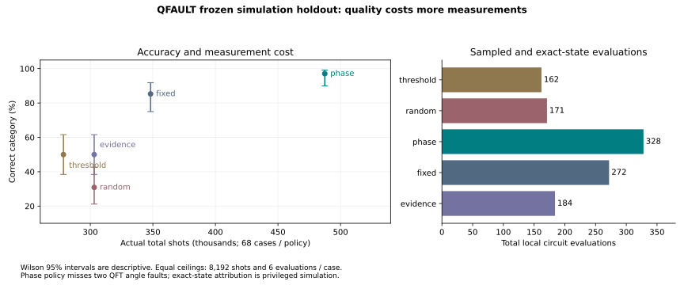

# Diagnostic audit and frozen evaluation

All results below were generated from real Qiskit reference-backend experiments. Aer conformance and the Aer live rehearsal are separate evidence; they do not replace the frozen corpus.

## Original benchmark reproduction and causes

The 75-case results and six selected repairs reproduced before changes and again on the current implementation. See benchmarks/stabilization-reproduction.json. Authoritative benchmarks/results.json and reproduction.json were not overwritten.

Evidence: 47/75, 343040 shots, 220 evaluations. Fixed: 66/75, 384000 shots, 300 evaluations. Random: 23/75, 343040 shots, 196 evaluations, 24 abstentions. Threshold: 47/75, 307200 shots, 186 evaluations. Threshold dominates original evidence on these accuracy/shot totals; no superiority claim is warranted.

The post-prediction audit in benchmarks/policy-audit.json links all 300 cases to measurements, actions, budgets and hypothesis support labels (there were no calibrated probability scores). Evidence's 28 errors comprise 19 logical/mixed cases indistinguishable from the contract in Z probabilities and nine noise cases unobservable or underpowered in Z. Of fixed's nine errors, six have weak/unobservable task evidence; three QFT readout cases collect significant calibration but the original decision ignores it when task Z disagreement is weak. These are distinct observability, evidence-selection and decision-use problems. Cause categories can overlap; they are evaluator analysis, never analyst inputs.

## New evidence and frozen split

Bell/GHZ X measurements reveal relative phase through product parity. For QFT basis k, qubit j receives Rz(-2πk2^j/2^n), then H; this cancels the analytically specified product phase. Global phase cancels in every probability. Basis gates experience the configured noise and their resources are charged. These are complementary witnesses, not tomography.

The phase policy collects at most 2048 complementary shots, then 1024 calibration shots if funded. Significant task-basis or calibration evidence triggers an exact ideal-state check and comparisons against the candidate's ideal distributions. The calculation remains privileged simulation. Calibration-only support is noise consistency, not necessarily task-output degradation. Unfunded required evidence abstains. Original policies and thresholds remain intact.

Configuration committed in 1d89eff8338a7c3f2bfec7ccb9bec794c7bbcb80 before implementation. Development uses Bell2/GHZ3/QFT3, seed71, 25 cases/policy. Phase 25/25 versus fixed22/25 costs 179200 versus128000 shots. Implementation committed in 30392152cd834318deecc250ac54eafbe2847aa0 before final evaluation. Final uses Bell2/GHZ4/QFT2/QFT4, seeds103/211, 68 cases/policy. No policy tuning followed final results. Later backend/export/boundary changes reproduced the same final metrics.

Equal ceilings per case: 8192 shots, 6 total evaluations; primary measurement 2048 shots; recovery disabled and evaluated separately. An evaluation includes exact state calculations, while an execution below means sampled circuit execution.

| Policy | Correct | Wilson 95% | Abstentions | Shots | Evaluations | Executions | Measured runtime (s) |
|---|---:|---:|---:|---:|---:|---:|---:|
| evidence | 34/68 | 38.4–61.6% | 0/68 | 303104 | 184 | 160 | 3.513 |
| fixed | 58/68 | 75.0–91.8% | 0/68 | 348160 | 272 | 204 | 4.689 |
| phase | 66/68 | 89.9–99.2% | 0/68 | 487424 | 328 | 272 | 6.052 |
| random | 21/68 | 21.2–42.6% | 13/68 | 303104 | 171 | 160 | 3.498 |
| threshold | 34/68 | 38.4–61.6% | 0/68 | 278528 | 162 | 136 | 3.064 |

Phase uses 40% more shots and 20.6% more evaluations than fixed, and misses QFT2 angle cases at both final seeds. Fixed catches every logical case with unconditional ideal-state evaluation. Phase's category improvement comes mostly from complementary/noise evidence, not improved logical recall. Fixed remains default; phase is an explicit higher-cost option. No statistical superiority or hardware claim is made.

## Final confusion matrices

Rows are evaluator truth; columns are predictions. Correct = no significant failure, Logical = logical defect, Noise = noise consistency, Mixed = mixed/ambiguous, Abstain = insufficient evidence. Configured noise truth is not proof of observable task degradation.

### evidence

| Truth / prediction | Correct | Logical | Noise | Mixed | Abstain |
|---|---:|---:|---:|---:|---:|
| Correct | 10 | 0 | 0 | 0 | 0 |
| Logical | 20 | 14 | 0 | 0 | 0 |
| Noise | 10 | 0 | 6 | 0 | 0 |
| Mixed | 4 | 0 | 0 | 4 | 0 |

### fixed

| Truth / prediction | Correct | Logical | Noise | Mixed | Abstain |
|---|---:|---:|---:|---:|---:|
| Correct | 10 | 0 | 0 | 0 | 0 |
| Logical | 0 | 34 | 0 | 0 | 0 |
| Noise | 10 | 0 | 6 | 0 | 0 |
| Mixed | 0 | 0 | 0 | 8 | 0 |

### phase

| Truth / prediction | Correct | Logical | Noise | Mixed | Abstain |
|---|---:|---:|---:|---:|---:|
| Correct | 10 | 0 | 0 | 0 | 0 |
| Logical | 2 | 32 | 0 | 0 | 0 |
| Noise | 0 | 0 | 16 | 0 | 0 |
| Mixed | 0 | 0 | 0 | 8 | 0 |

### random

| Truth / prediction | Correct | Logical | Noise | Mixed | Abstain |
|---|---:|---:|---:|---:|---:|
| Correct | 10 | 0 | 0 | 0 | 0 |
| Logical | 20 | 6 | 0 | 0 | 8 |
| Noise | 10 | 0 | 3 | 0 | 3 |
| Mixed | 4 | 0 | 0 | 2 | 2 |

### threshold

| Truth / prediction | Correct | Logical | Noise | Mixed | Abstain |
|---|---:|---:|---:|---:|---:|
| Correct | 10 | 0 | 0 | 0 | 0 |
| Logical | 20 | 14 | 0 | 0 | 0 |
| Noise | 10 | 0 | 6 | 0 | 0 |
| Mixed | 4 | 0 | 0 | 4 | 0 |

Class denominators are 10 correct, 34 logical, 16 noise and 8 mixed. Phase recalls 10/10,32/34,16/16,8/8 respectively; fixed 10/10,34/34,6/16,8/8. Every policy has 0/10 false diagnoses on evaluator-correct cases, including eight explicit clean cases and two equivalent mutations; Wilson upper bound 27.8%, so zero population error is unestablished. Random selective accuracy is 21/55; other policies do not abstain in this final split.

The separate 64-shot control contains four cases/policy. Phase/evidence/threshold/random abstain 4/4 using 512 shots; fixed correctly attributes two phase defects with privileged state checks and abstains on two clean cases, using4608 shots. Abstention is counted separately and is not silently removed from overall accuracy.

## Recovery and negative controls

benchmarks/recovery-stabilization.json covers 12 selected missing-gate/phase trials: 10 verified, two QFT4 phase repairs inconclusive because the fresh Z-distribution upper bound exceeds0.10. Wilson95% interval55.2–95.3% is descriptive for these selected cases. Each uses11264 total shots,25–118 total evaluations. Submitted circuit hashes remain unchanged and all exports verify.

Selection uses Statevector; validation separately evolves DensityMatrix and uses new Z and phase samples at seed+10007 and +10024. Validation costs are reserved before phase candidate search. Two attractive negative proposals are rejected: a phase-wrong circuit with matching Z counts, and a logically correct circuit with systematic readout noise. Neither is counted as a successful repair. The prior6/6 applies only to its selected Bell/GHZ missing-gate corpus.

## Reproduce and interpret

Use README commands for the dependency bridge, evaluate --split final --out a-new-directory, scripts.evaluate_recovery and scripts.compare_backends. All destinations are exclusive. Raw artifact directories and manifest hashes are recorded in each JSON row. Scientific reproduction compares predictions, confusion matrices and resources; IDs, timestamps, runtime and implementation hashes can differ.

This is a small fixed-template simulation study with two final seeds, not unseen-algorithm generalization. Wilson intervals do not account for repeated circuit structure. Additional bases improve information but remain incomplete; the two missed angle faults are retained. Noise consistency cannot identify every physical cause. No quantum advantage, first-place outcome, general automated repair or scientific novelty has been established.
