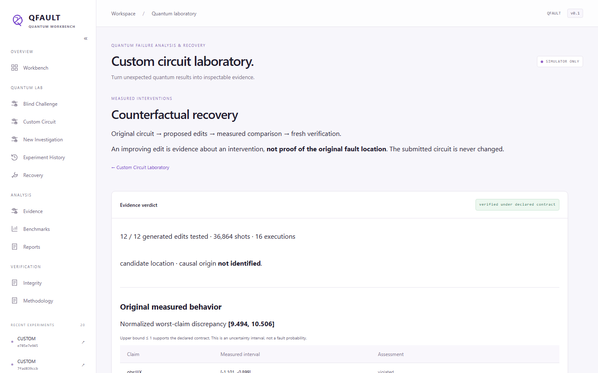

# External circuit validation

This study uses independently sourced programs, a trusted unmodified reference,
and measurement-only QFAULT decisions. It establishes bounded simulator results,
not arbitrary-program generalization, hardware performance, or causal diagnosis.
The research commits remain local; the published release is `35cbbb9`.

## Source and eligibility

QASMBench is pinned at
[`357b942396d5c2b7cbc1c229c585a6ef5ccaebac`](https://github.com/pnnl/QASMBench/tree/357b942396d5c2b7cbc1c229c585a6ef5ccaebac).
The complete [inventory](../configs/external-corpus.json) covers 252 QASM paths:
132 canonical originals and 120 transpiled variants. The variants are duplicates
for architecture counting. Of the originals, 101 exceed the 2–5-qubit scope;
31 bounded originals were inspected and 14 are eligible. The other 17 fail the
explicit static adapter, instruction, gate-count, or parsing limits. Dynamic
control, reset, interior measurement, custom gate definitions, and unknown gates
are rejected. Unparsed large files have unknown depth/vocabulary fields, rather
than invented measurements. Every path has an inclusion/exclusion reason.

The 31 small originals, exact upstream LICENSE/NOTICE, and complete tree metadata
are [vendored](../benchmarks/external/qasmbench). Byte preservation is enforced
by `.gitattributes`. Redistribution follows the custom Battelle terms, not
QFAULT's MIT grant.

The adapter strips and records terminal measurements and barriers, retains
measurement mappings, and translates an explicit standard-gate vocabulary in
source order at optimization level zero. It applies no cancellation or circuit
shortening to meet the 32-gate limit. Full operators of accepted imports agree
with the source up to one common global phase, across all computational inputs.
This import check does not prove that the upstream algorithm is correct.
Noise is applied per translated logical gate. A decomposition changes that
noise model's gate count; unitary import equivalence is not equivalence of noisy
channels or of a device's native transpilation. All compared policies see the
same translated circuit and environment.

Sorted eligible paths with index modulo three equal to zero form development:
adder, Fredkin, iSWAP, repetition encoder, and teleportation. The remaining nine
form holdout: cat state, Deutsch, Grover, hidden subgroup (`hs4`), linear solver,
learning parity (`lpn`), QFT, QRNG, and Toffoli. These are nine external source
programs, not nine wholly new quantum architectures: some overlap familiar
state-preparation and QFT structures. Repeated seeds are never counted as new
programs. The split was set before diagnostic outcomes.

## Oracle and frozen protocol

The expected contract comes from separately parsing the original unmodified
QASM with Qiskit, before constructing mutations. The trust assumption is that
source and Qiskit's semantics are correct. No candidate output defines its own
contract. Every program starts from the canonical zero input; source preparation
gates remain part of the program. The trusted oracle is reference-relative, not
an independently proved full algorithm specification.

Three contracts are separate tasks: Z distribution (TV tolerance .15), up to
12 largest reference Pauli expectations with magnitude at least .2 (tolerance
.2), and pure target state (infidelity tolerance .2). The Pauli subset is
incomplete and need not provide tomography. Under noisy analysis, its truth is
the expectation of the executed measurement setting, not an inferred noiseless
preanalysis state. Target-fidelity claims abstain under uncalibrated noise.

The [protocol](../configs/external-validation-protocol.json) was committed at
`cac14a5` before holdout execution. Its scientific sources are pinned by normalized
LF SHA-256 values, with source revision `7f75a29`. The summary records execution
revision `6eaeb2d`; that intervening commit adds demonstration/audit material and
does not change the frozen scientific sources. Source, dependency, corpus and
licensing hashes were checked. Dirty or mismatched sources are refused.

Development used seed 1701. Holdout seeds are 91001 and 91002. Variants include
clean controls, first-gate/first-entangler deletion, terminal Z on qubit zero,
readout noise .12, per-gate depolarizing noise .03, mixed deletion/noise, and a
64-shot/128-total-shot stress case. Target contracts also receive a global-phase
negative control. QRNG has no entangler, so that mutation is explicitly
unsupported: 26 policy/seed rows, not silently substituted first-gate deletions.
Some edits leave the fixed-input state or incomplete contract unchanged; an edit
name alone is not a ground-truth observable fault.

Diagnostic ceilings are 12,288 shots, 16 executions, four looks per group, and
alpha .01. Recovery ceilings and candidate order are fixed in the protocol;
no reference circuit or injected locus enters recovery. Fixed, complementary,
adaptive, weighted-target and random policies use matched information and
ceilings within each contract task. Template threshold diagnosis has no defined
arbitrary-contract implementation and is not invented as a comparator.

## Frozen results

The [summary](../benchmarks/external-holdout-v1/summary.json) contains 1,962
diagnostic rows and 270 recovery rows across nine programs. There were no
execution errors. The [compressed archive](../benchmarks/external-holdout-v1/reports.jsonl.gz)
contains all 2,206 executed report bundles; independent verification checked
membership, digests, outcomes, cost ledgers, evaluator metadata, and recounted
aggregates. The remaining 26 rows record unsupported mutations. Total diagnostic
shots were 5,586,240; recovery comparisons used another 11,851,776. The entire
Windows evaluation took 610.38 seconds including oracle and artifact work.

| Contract / policy | Runs | Oracle violations | Detected | False violations | Unresolved | Shots / executions |
|---|---:|---:|---:|---:|---:|---:|
| Z distribution: each of four policies | 144 | 82 | 70 | 0 | 16 | 208,384 / 226 |
| Pauli: fixed / complementary | 144 | 108 | 102 | 0 | 8 | 658,368 / 672 |
| Pauli: adaptive | 144 | 108 | 103 | 0 | 7 | 634,816 / 649 |
| Pauli: random | 144 | 108 | 102 | 0 | 12 | 765,952 / 778 |
| Target: fixed / weighted | 162 | 58 | 49 | 0 | 63 | 385,728 / 402 |
| Target: adaptive witness | 162 | 58 | 49 | 0 | 63 | 384,704 / 401 |
| Target: complementary | 162 | 58 | 49 | 0 | 63 | 390,848 / 407 |
| Target: random | 162 | 58 | 48 | 0 | 68 | 488,192 / 503 |

Each policy has two unsupported rows. Target policies additionally have 54
uncalibrated-noise rows apiece; those are unresolved and excluded from state
truth denominators. There are 60 checkable nonviolations per distribution policy,
34 per Pauli policy, and 48 per target policy. Zero observed false violations is descriptive,
not a zero population error rate. Different contract denominators must not be
combined into one accuracy score.

Every program's outcomes appear separately in the summary. Adaptive Pauli
detection by program was cat 12/14, Deutsch 10/10, Grover 12/12, hs4 11/12,
linear solver 13/14, lpn 14/14, QFT 12/12, QRNG 9/10, and Toffoli 10/10.
These correlated variants and repeated seeds do not support an independent-run
bootstrap or a population superiority claim. The one-run gain over fixed is
small and descriptive. Target methods mostly tie; there is no evidence here
that sophisticated selection is uniformly better.

All 530 checkable target intervals contained the oracle fidelity; this is 106
cases per policy, not 530 independent programs. Mean widths were .2931 fixed,
.2938 adaptive, .2896 complementary, and .2924 random. Nine ideal low-shot
adaptive cases remained unresolved. Dense non-Clifford confirmation and broad
scalability remain unestablished; the import limits exclude many such workloads.

| Recovery policy | Runs | Eligible | Selected | Fresh verified | Fresh rejected | Noise-only proposals | Shots / executions |
|---|---:|---:|---:|---:|---:|---:|---:|
| Conservative | 90 | 41 | 18 | 10 | 8 | 0 | 5,337,088 / 2,498 |
| Point discrepancy | 90 | 41 | 41 | 10 | 31 | 13 | 5,902,336 / 2,636 |
| No repair | 90 | 41 | 0 | 0 | 0 | 0 | 612,352 / 299 |

Each selection policy generated 2,880 candidates and tested 1,039; the no-repair
control generated the same lists but executed none. Conservative also retained
28 insufficient-evidence, 18 readout-control abstentions and 26 no-repair-needed
outcomes. Its 10 verifications cover five programs at two seeds each. Eight
fresh rejections occurred on Deutsch first-gate deletion, linear-solver deletion
and phase, and QFT deletion. Screening improvement need not restore the contract.
Fresh verification correctly prevents those proposals from becoming successes.

Of 28 searched cases with an evaluator-designated mutation index, 20 plausible
location sets contained that index. This is index coverage within the tested
one-edit set, not patch correctness or causal identification. Sets retain
multiple candidates and untested alternatives. Truncated generation, candidate
order and finite budgets remain substantive limitations. No unique causal
attribution or full program equivalence was established.

## Failure evidence

The complete row-level taxonomy retains: 212 edited cases within tolerance or
unobservable under the contract; 109 shot-budget misses; eight look-limit misses;
270 uncalibrated target-model rows; and 26 unsupported mutations. Counts pool
policies, so they are not independent faults. There were 933 detected operational
discrepancy rows and 404 remaining no-false-violation rows.

Examples include cat-state terminal Z passing the Z contract; cat-state
low-shot deletion failing to resolve; lpn gate noise reaching its look limit;
and cat-state readout noise withholding target-state certification. The raw
records, interval widths and stop codes support these classifications. A mutation
name alone does not decide the failure reason. No outcome was used to change
thresholds, candidate order or policy heuristics after freezing.

## Reproduce and inspect

Use the README's locked installation from this research revision, then:

```powershell
python -m pip check
python -m scripts.retrieve_external_sources --verify
python -m scripts.external_corpus --output artifacts/rebuilt-external-corpus.json
python -m scripts.verify_external_results benchmarks/external-holdout-v1/summary.json benchmarks/external-holdout-v1/reports.jsonl.gz
python -m scripts.external_validation --split development --out artifacts/my-external-development
python -m scripts.external_validation --split holdout --out artifacts/my-external-holdout
```

Outputs must be new directories. The corpus rebuild should match the committed
JSON byte-for-byte; `--verify` checks both SHA-256 and upstream Git blob hashes.
Optional retrieval uses `python -m scripts.retrieve_external_sources --out
artifacts/fresh-qasmbench-sources`. No network is needed for the vendored study.
The frozen holdout runner requires clean committed scientific sources. Do not
regenerate its protocol or overwrite committed results. Runtime, IDs, timestamps
and archive digests may differ on rerun; compare scientific decisions, sampled
counts, seeds and actual resource use separately.

With the server running, execute the unfamiliar-circuit demonstration:

```powershell
python -m scripts.external_demo --out artifacts/my-external-demo
python -m qfault verify-report artifacts/my-external-demo/recovery-report.json
python -m scripts.external_demo_e2e --out artifacts/my-external-browser
```

The [recorded API demo](../benchmarks/external-demo-v1/summary.json) uses the
unchanged external QRNG reference plus a separately declared terminal Z. Its
Z-only investigation misses the relative phase, complementary X measurements
detect it, and a bounded intervention passes independent fresh confirmation.
The four stages used 81,920 shots and 40 executions; all exports verify. This is
a deliberately simple observability example, not a representative repair rate.
The separate editor/browser run used its own declared default budget, passed
390/375/360-pixel checks, and records its IDs in
[browser-summary.json](../benchmarks/external-demo-v1/browser-summary.json).



Scientific assumptions and corrections: [information-boundary audit](information-boundary-audit.md).
Prior work and the executed stronger-oracle example: [competitor comparison](competitor-comparison.md).
Platform verification: [current state](current-state.md).
